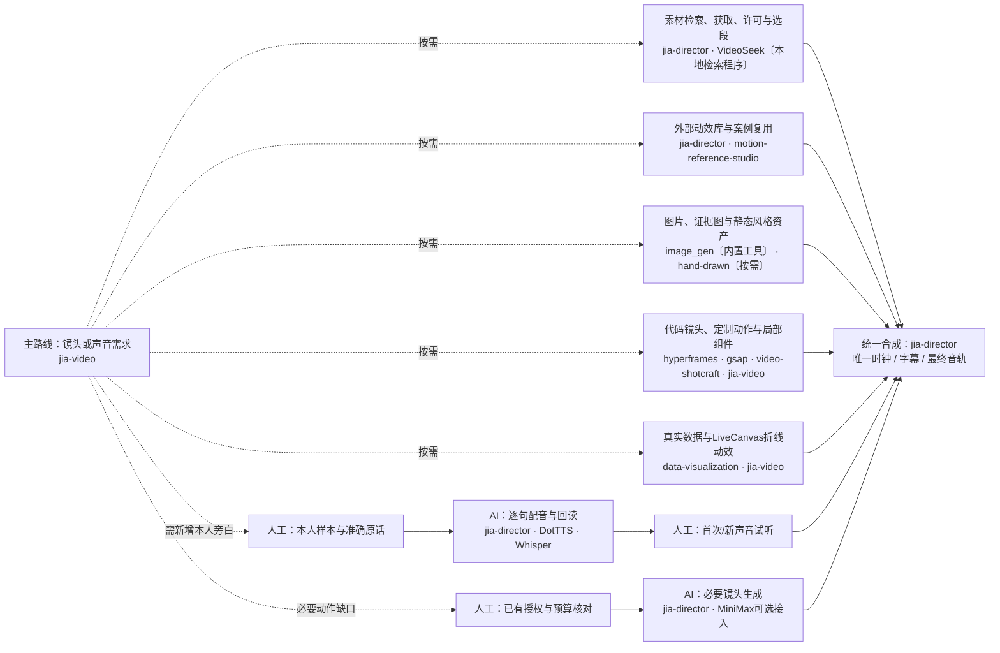

> 当前正式入口为jia-director 1.2.0；源码制作、AI/人工职责与新增执行入口见[源码驱动流程图](source-backed.md)。原有制作分支见[制作方式与项目落位图](../assets/review/制作方式与项目落位.html)及[交接接口](production-modes.md)。下方40节点、63文件与原回执为历史完整复核基线，保留原文，不代表其中所有待决定项已获确认。

当前制作须先执行[王杰已采用的花叔13项规则](huashu-rules.md)及其明确适用范围；本文保留的旧方法、组件或历史案例不是豁免。新方向三构图选择为人工节点，流程图标红；已确认方向的常规修订不重复选型。

> 本文为封装前的完整复核基线，正式入口现为导演系统 `jia-director` 1.0.0；历史版本与待决定项按原文保留。

# Jia-video完整复核稿 v1.2

**状态：供王杰完整复核与修改，不代表流程已认可；正式Skill保持3.1.1，本轮不改。**

完整保存当前Skill的63个文件，逐文件校验SHA256；正文将能力落到节点，附原文快照与覆盖清单。程序和上游资料是来源，不自动获得执行权限。

## 使用方式

先看[可点击流程图](../assets/review/完整流程图与复核.html)，每个节点都有AI/人工职责、Skill/程序、产物、验收、边界与原文；可逐节点写意见并导出。也可直接修改本Markdown。备注不自动回传，也不改变正式Skill。

## 两条路线与Skill流程图

### 口播路线

原片 → 校对 → 粗剪 → 精剪 → 补画面；先让内容和原声成立

```mermaid
flowchart TD
  topic["人工：人工选题与目标"]
  setup["AI：立项、接续与环境检查<br/>jia-video"]
  writing["AI：研究、稿件与事实核查<br/>local-content-research-v5 · jia-ai-writing / jia-human-writing · editorial-review"]
  content_review["人工：人工复核内容与素材方案"]
  recording["人工：真人录制或承接已有原片"]
  transcript["AI：原片登记、ASR与真实校对<br/>jia-director · 本地Whisper〔程序〕"]
  rough["AI：语义粗剪、逐词面板与导出<br/>jia-video"]
  rough_human["人工：人工检查内容取舍〔按项目节奏〕"]
  fine["AI：精剪底片、原声与帧级切点<br/>jia-video"]
  visual_plan["AI：按精剪台词确定补画面需求<br/>jia-video"]
  reference["AI：参考片拆解与原创迁移〔可选〕<br/>video-recreation"]
  design["AI：视觉规范、导演与动作规则<br/>HeiGe-Design · video-shotcraft · motion-reference-studio · hand-drawn〔静帧〕 · jia-video"]
  oral_proof["AI：新风格解释插段试作〔按需〕<br/>jia-director · hyperframes / gsap"]
  style_review["人工：人工复核新风格与代表段"]
  material["AI：素材检索、获取、许可与选段<br/>jia-director · VideoSeek〔本地检索程序〕"]
  visual_insert["AI：制作、登记并导入补图结果<br/>jia-director · image_gen / hyperframes / gsap"]
  compose["AI：统一成片时间线、字幕与最终音轨<br/>jia-director · hyperframes / FFmpeg〔程序〕"]
  qa["AI：媒体技术检查与声音测量<br/>jia-director · FFmpeg / FFprobe〔程序〕"]
  creative["AI：AI实际创作审查与复听覆盖<br/>jia-director · visual-acceptance〔按需〕"]
  draft1["人工：人工完整审片：初稿待确认"]
  revision["AI：按反馈修改、保留版本并复检<br/>jia-video"]
  final["人工：人工复核第二稿并确认定稿"]
  delivery["AI：工程归档、复用积累与交付<br/>jia-director · neat-obsidian / immortal-memory〔按授权〕"]
  packaging["AI：封面、平台文案与发布材料<br/>xenho-cover〔按需〕 · image_gen〔内置工具〕 · 平台Skill〔有授权且可用〕"]
  publish["人工：人工发布与复盘定方向"]
  topic --> setup
  setup --> writing
  writing --> content_review
  content_review --> recording
  recording --> transcript
  transcript --> rough
  rough -. "按需 / 见节点条件" .-> rough_human
  rough_human -. "按需 / 见节点条件" .-> fine
  fine --> visual_plan
  visual_plan -. "按需 / 见节点条件" .-> reference
  reference -. "按需 / 见节点条件" .-> design
  design -. "按需 / 见节点条件" .-> oral_proof
  oral_proof -. "按需 / 见节点条件" .-> style_review
  style_review -. "按需 / 见节点条件" .-> material
  material --> visual_insert
  visual_insert --> compose
  compose --> qa
  qa --> creative
  creative --> draft1
  draft1 --> revision
  revision --> final
  final --> delivery
  delivery --> packaging
  packaging --> publish
  final -- "需修改" --> revision
  revision --> qa
```

图中虚线节点按实际条件进入；不意味着必须先把所有素材后端串行跑一遍。角色、声音与预算的确认仅在对应条件成立时发生。

### 无口播路线

脚本与实际时钟 → 分镜 → 代表段/预演 → 镜头生产；允许旁白、音乐或无声

```mermaid
flowchart TD
  topic["人工：人工选题与目标"]
  setup["AI：立项、接续与环境检查<br/>jia-video"]
  writing["AI：研究、稿件与事实核查<br/>local-content-research-v5 · jia-ai-writing / jia-human-writing · editorial-review"]
  content_review["人工：人工复核内容与素材方案"]
  reference["AI：参考片拆解与原创迁移〔可选〕<br/>video-recreation"]
  design["AI：视觉规范、导演与动作规则<br/>HeiGe-Design · video-shotcraft · motion-reference-studio · hand-drawn〔静帧〕 · jia-video"]
  sound["AI：声音方案与实际时钟<br/>jia-video"]
  voice_sample["人工：人工提供本人样本与准确原话〔条件〕"]
  voice["AI：本人配音〔仅需新增旁白时〕<br/>jia-director · DotTTS SOAR / audio.cpp〔程序〕 · Whisper〔程序〕"]
  voice_human["人工：人工声音确认〔新增本人音色时〕"]
  storyboard["AI：分镜与镜头事件设计<br/>jia-director · video-shotcraft"]
  proof["AI：代表段与完整可播放预演<br/>jia-director · hyperframes / 已有Remotion"]
  style_review["人工：人工复核新风格与代表段"]
  backend["AI：选择本期动画后端<br/>hyperframes〔本机可用〕 · heige-video〔待接入〕 · riso-film / riso-still / riso-score〔待接入〕"]
  asset_dispatch["AI：镜头资产生产〔按任务选用〕<br/>jia-director · hyperframes / gsap · image_gen〔图片〕 · data-visualization〔数据〕"]
  compose["AI：统一成片时间线、字幕与最终音轨<br/>jia-director · hyperframes / FFmpeg〔程序〕"]
  qa["AI：媒体技术检查与声音测量<br/>jia-director · FFmpeg / FFprobe〔程序〕"]
  creative["AI：AI实际创作审查与复听覆盖<br/>jia-director · visual-acceptance〔按需〕"]
  draft1["人工：人工完整审片：初稿待确认"]
  revision["AI：按反馈修改、保留版本并复检<br/>jia-video"]
  final["人工：人工复核第二稿并确认定稿"]
  delivery["AI：工程归档、复用积累与交付<br/>jia-director · neat-obsidian / immortal-memory〔按授权〕"]
  packaging["AI：封面、平台文案与发布材料<br/>xenho-cover〔按需〕 · image_gen〔内置工具〕 · 平台Skill〔有授权且可用〕"]
  publish["人工：人工发布与复盘定方向"]
  topic --> setup
  setup --> writing
  writing --> content_review
  content_review -. "按需 / 见节点条件" .-> reference
  reference -. "按需 / 见节点条件" .-> design
  design --> sound
  sound -. "按需 / 见节点条件" .-> voice_sample
  voice_sample -. "按需 / 见节点条件" .-> voice
  voice -. "按需 / 见节点条件" .-> voice_human
  voice_human -. "按需 / 见节点条件" .-> storyboard
  storyboard --> proof
  proof -. "按需 / 见节点条件" .-> style_review
  style_review -. "按需 / 见节点条件" .-> backend
  backend --> asset_dispatch
  asset_dispatch --> compose
  compose --> qa
  qa --> creative
  creative --> draft1
  draft1 --> revision
  revision --> final
  final --> delivery
  delivery --> packaging
  packaging --> publish
  final -- "需修改" --> revision
  revision --> qa
```

图中虚线节点按实际条件进入；不意味着必须先把所有素材后端串行跑一遍。角色、声音与预算的确认仅在对应条件成立时发生。

## 公共能力支线图

## 完整节点说明

### topic · 人工选题与目标

**责任：王杰人工；Skill/程序：人工职责，不由Skill代签。**

王杰自己选题，确定观点、受众、用途和希望观众获得什么。AI承接已给定主题，不默认搜热点、评分或换题。

- 产物：主题、观点、受众、平台、时长、画幅、现有素材与授权范围
- 复核：由本人确认选题与核心表达。
- 边界：已有选题Skill保留，但不自动进入生产；用户另行要求时才协助比较。

原文：[SKILL.md](../assets/review/jia-video原文快照/SKILL.md.txt) · [references/ai-human-review.md](../assets/review/jia-video原文快照/references/ai-human-review.md)

### setup · 立项、接续与环境检查

**责任：AI执行与自检；Skill/程序：jia-director。**

读取工程与当前断点，探测真实素材，运行已配置doctor，核对工具、输入、版本及授权。新项目使用既有E盘归档规则。

- 产物：brief、现有脚本/design/分镜、真实素材参数、运行检查、工程路径
- 复核：保留用户改动、旧文件、锁定表达；没有素材不能以封面冒充已看片。
- 边界：doctor只证明检查范围；不证明远程余额、本人音色或创作质量。无A-roll不伪登记原片。

原文：[SKILL.md](../assets/review/jia-video原文快照/SKILL.md.txt) · [references/runtime.md](../assets/review/jia-video原文快照/references/runtime.md) · [references/capabilities.md](../assets/review/jia-video原文快照/references/capabilities.md) · [scripts/run-video.ps1](../assets/review/jia-video原文快照/scripts/run-video.ps1)

### writing · 研究、稿件与事实核查

**责任：AI执行与自检；Skill/程序：local-content-research-v5、jia-ai-writing / jia-human-writing、editorial-review。**

按已选主题整理原始资料、可靠事实和资产，写脚本及画面功能；已有锁定稿只核查，不擅自重写。

- 产物：脚本、事实表、来源、待核实项、素材缺口
- 复核：姓名、数字、单位、否定词、条件、因果和时效性逐项检查；金融保险事实核当前权威来源。
- 边界：保险子Skill目前暂停，使用jia-human-writing；未真正调用第二AI就不称独立双审。

原文：[references/create-video.md](../assets/review/jia-video原文快照/references/create-video.md) · [references/edit-source.md](../assets/review/jia-video原文快照/references/edit-source.md) · [references/ai-human-review.md](../assets/review/jia-video原文快照/references/ai-human-review.md)

### content_review · 人工复核内容与素材方案

**责任：王杰人工；Skill/程序：人工职责，不由Skill代签。**

复核核心表达、关键事实、个人立场、不可改条件及素材采用方式。

- 产物：具体稿件/方案版本、修改意见、确认或待定记录
- 复核：意见对应真实版本；有实质变更就重查受影响范围。
- 边界：HeiGe资料转故事路径要求真实脚本及素材复用/重做/混合确认；当前未接入，不伪填批准。

原文：[references/ai-human-review.md](../assets/review/jia-video原文快照/references/ai-human-review.md) · [references/style-routing.md](../assets/review/jia-video原文快照/references/style-routing.md)

### reference · 参考片拆解与原创迁移〔可选〕

**责任：AI执行与自检；Skill/程序：video-recreation。**

覆盖全片并加密切点与关键动作，按时间码拆构图、材质、主体变化、镜头、声音和跨镜承接，迁移到自己的内容。

- 产物：reference-analysis、镜头映射、原创brief、逐镜提示词与证据索引
- 复核：区分观察、推断、未核实及实际看/听覆盖；参考事实和素材不自动获得复用授权。
- 边界：该Skill负责分析交接，不接管成片时间线；本机适配版不启用上游Coze/Suno/Edge-TTS等管线。

原文：[references/style-routing.md](../assets/review/jia-video原文快照/references/style-routing.md) · [references/talking-head.md](../assets/review/jia-video原文快照/references/talking-head.md) · [references/no-talking-head.md](../assets/review/jia-video原文快照/references/no-talking-head.md)

### design · 视觉规范、导演与动作规则

**责任：AI执行与自检；Skill/程序：HeiGe-Design、video-shotcraft、motion-reference-studio、hand-drawn〔静帧〕、jia-video。**

把风格写成颜色、字体、材质、构图、角色比例和动作性格。逐镜明确观看重点、起态→动作→落态、相机目的、声音/阅读锚点及跨镜承接。

- 产物：design/motion规范、镜头表、真实可播放代表段计划
- 复核：动作服务因果与注意力；检查中间态，不把静态好看或特效数量当成镜头质量。
- 边界：不固定每镜五层、运镜、弹簧或切镜秒数；字卡、图表、稳定阅读有任务时允许使用。

原文：[references/motion-direction.md](../assets/review/jia-video原文快照/references/motion-direction.md) · [references/shot-recipes.md](../assets/review/jia-video原文快照/references/shot-recipes.md) · [references/motion-library.md](../assets/review/jia-video原文快照/references/motion-library.md) · [references/style-routing.md](../assets/review/jia-video原文快照/references/style-routing.md)

### style_review · 人工复核新风格与代表段

**责任：王杰人工；Skill/程序：人工职责，不由Skill代签。**

新风格或大改时，实际看代表段的构图、质感、动作、承接与声音，确定账号规则和红线。

- 产物：风格反馈、具体代表段版本、认可或修改记录
- 复核：认可的是该作品/版本及可复用规则，不是作者上游发布状态。
- 边界：已认可规则内不逐镜重复等待；固定流程与美术原则，不把旧片机械换文字。

原文：[references/ai-human-review.md](../assets/review/jia-video原文快照/references/ai-human-review.md) · [references/motion-quality.md](../assets/review/jia-video原文快照/references/motion-quality.md) · [references/motion-archive.md](../assets/review/jia-video原文快照/references/motion-archive.md)

### recording · 真人录制或承接已有原片

**责任：王杰人工；Skill/程序：人工职责，不由Skill代签。**

以本人讲述、访谈或人物表达为主线。已有足够原片就直接用；只有脚本时先完成真实录制。

- 产物：原始录制及用途、应保留的表达/反应、已有脚本
- 复核：录音清楚、原始文件保留；语气与个人判断由本人决定。
- 边界：没有原片只能交录制准备，不能声称剪辑已完成。

原文：[references/talking-head.md](../assets/review/jia-video原文快照/references/talking-head.md) · [references/edit-source.md](../assets/review/jia-video原文快照/references/edit-source.md)

### transcript · 原片登记、ASR与真实校对

**责任：AI执行与自检；Skill/程序：jia-director、本地Whisper〔程序〕。**

记录SHA、时长、画幅、帧率、音轨与字幕，ASR辅助定位，回查实际原话；记录全片核查覆盖。

- 产物：校对稿、原片时间索引、真实登记与核查记录
- 复核：姓名、数字、否定、条件、重录回听；不确定原意交本人。
- 边界：ASR token不是精确中文逐词或修改稿强制对齐；核心review-transcript只改句子，不重排旧words。

原文：[references/edit-source.md](../assets/review/jia-video原文快照/references/edit-source.md) · [references/rough-review.md](../assets/review/jia-video原文快照/references/rough-review.md) · [references/runtime.md](../assets/review/jia-video原文快照/references/runtime.md) · [references/talkcraft-adapter.md](../assets/review/jia-video原文快照/references/talkcraft-adapter.md)

### talkcraft · 可选词表与EDL交换桥

**责任：AI执行与自检；Skill/程序：jia-director、Talkcraft原创离线桥〔程序〕。**

需要时导出绑定真实源文件的ASR原始词表，或导入并核查EDL的cuts/keep、源目标时间和真实媒体参数，产待复核候选。

- 产物：words与binding、pending-review候选、真实源/词表/EDL散列
- 复核：同长不证明同一录音或零偏移；改后句子不能伪造原词表；候选不能自动变成已批准核心剪辑。
- 边界：原创桥保留，上游video-talkcraft仍未启用；PolyForm非商用许可，不能假称已获商业使用授权。它不替代粗剪、精剪、原声和用户门禁。

原文：[references/talkcraft-adapter.md](../assets/review/jia-video原文快照/references/talkcraft-adapter.md) · [references/runtime.md](../assets/review/jia-video原文快照/references/runtime.md)

### rough · 语义粗剪、逐词面板与导出

**责任：AI执行与自检；Skill/程序：jia-director。**

提出有理由的删改候选，在面板可恢复、校字、看波形和原片/粗剪预览；先决定讲什么，导出真实粗剪。

- 产物：粗剪MP4、SRT、删改理由、原片→粗剪映射、fine-cut.handoff.json
- 复核：保留主语、因果、限定条件、表情与自然停顿；不能只按静音剪或拼出原话没有的结论。
- 边界：面板保持原片顺序，不支持任意句序重排；改字不等于删录音。长间隔只是候选。

原文：[references/rough-review.md](../assets/review/jia-video原文快照/references/rough-review.md) · [references/edit-source.md](../assets/review/jia-video原文快照/references/edit-source.md) · [references/runtime.md](../assets/review/jia-video原文快照/references/runtime.md)

### rough_human · 人工检查内容取舍〔按项目节奏〕

**责任：王杰人工；Skill/程序：人工职责，不由Skill代签。**

需要时在逐词面板复核语义、恢复删段并记录原意。连续制作授权内完成真实检查后继续，不为每次保存额外审批。

- 产物：保留/删除/恢复意见及对应版本
- 复核：争议删改回听本人原话；校对状态不是全片已审证据。
- 边界：本节点存在是为了明确人工职责，不把每次导出都设为强制等待。

原文：[references/rough-review.md](../assets/review/jia-video原文快照/references/rough-review.md) · [references/ai-human-review.md](../assets/review/jia-video原文快照/references/ai-human-review.md)

### fine · 精剪底片、原声与帧级切点

**责任：AI执行与自检；Skill/程序：jia-director。**

绑定真实粗剪版本，调字头字尾、呼吸、停顿和反应，导出有声精剪底片，再进入补图。

- 产物：精剪MP4、SRT、粗剪→精剪映射、原片映射副本、QA与回执
- 复核：实际看切点并听接缝；完整表达和自然节奏不靠补图掩盖。
- 边界：只能用该粗剪真实存在的帧；恢复已删原片、语义重删或改序回粗剪。切点摘要不等于人工听审。

原文：[references/fine-cut.md](../assets/review/jia-video原文快照/references/fine-cut.md) · [references/review-stages.md](../assets/review/jia-video原文快照/references/review-stages.md) · [references/edit-source.md](../assets/review/jia-video原文快照/references/edit-source.md)

### visual_plan · 按精剪台词确定补画面需求

**责任：AI执行与自检；Skill/程序：jia-director。**

将证据、过程、机制与情绪分清：A-roll承载关系/态度/情绪/结论，B-roll证明与展示，MG解释抽象结构。

- 产物：绑定精剪输出区间的补图表、用途、来源与验收条件
- 复核：不逐句铺满，不遮脸/硬字幕/关键界面，不为了特效改变台词。
- 边界：补图面板支持右上/右下/全屏及有界视频；复杂透明层、人物小窗和多轨另做工程。

原文：[references/review-stages.md](../assets/review/jia-video原文快照/references/review-stages.md) · [references/edit-source.md](../assets/review/jia-video原文快照/references/edit-source.md)

### sound · 声音方案与实际时钟

**责任：AI执行与自检；Skill/程序：jia-director。**

有旁白先确定实际声音，有音乐以真实结构/拍点定时；无声按阅读与事件节奏安排，不自动添加BGM。口播保留原声。

- 产物：声音方式、定版音轨、实际时长与cue、锁定稿版本
- 复核：改词/换声音/剪切后更新字幕、镜头和映射；横竖版分别重排构图。
- 边界：正式本人音色尚未试听确认；已有音乐不代表可复用。librosa是候选分析库，不是自动导演。

原文：[references/voice-and-timing.md](../assets/review/jia-video原文快照/references/voice-and-timing.md) · [references/personal-voice.md](../assets/review/jia-video原文快照/references/personal-voice.md) · [references/create-video.md](../assets/review/jia-video原文快照/references/create-video.md)

### voice_sample · 人工提供本人样本与准确原话〔条件〕

**责任：王杰人工；Skill/程序：人工职责，不由Skill代签。**

仅需要新增本人旁白时，明确选定本人原始录音、实际截取段落的准确原话、用途和本地推理范围，再交AI建档。

- 产物：本人录音、起止点、准确参考文字、用途与已有确认
- 复核：样本文字必须对应所选短片段；不是整段长稿，也不能把未校对ASR当准确原话。
- 边界：没有明确样本不制造空壳档案；不取教程/参考视频的人声，不自动上传到远程服务。

原文：[references/personal-voice.md](../assets/review/jia-video原文快照/references/personal-voice.md) · [references/ai-human-review.md](../assets/review/jia-video原文快照/references/ai-human-review.md)

### voice · 本人配音〔仅需新增旁白时〕

**责任：AI执行与自检；Skill/程序：jia-director、DotTTS SOAR / audio.cpp〔程序〕、Whisper〔程序〕。**

用本人明确选定录音及准确截取原话建档，锁定文本逐句合成；保留各take，错误句最多一次追加尝试，用实际WAV定cue。无声、纯音乐或已有定版录音时跳过此节点。

- 产物：reference.wav/txt、profile/manifest；candidate.wav、cue、batch.receipt、QA
- 复核：模型/runner/样本/用途核对；逐句检查漏读、数字、术语、断句、相似度与自然度。
- 边界：建议8–10秒，接口3–15秒；不自动换MOSS、系统声或远程声音。ASR差异是候选，不自动判定误读；没有跨批resume。

原文：[references/personal-voice.md](../assets/review/jia-video原文快照/references/personal-voice.md) · [references/voice-and-timing.md](../assets/review/jia-video原文快照/references/voice-and-timing.md) · [references/runtime.md](../assets/review/jia-video原文快照/references/runtime.md)

### voice_human · 人工声音确认〔新增本人音色时〕

**责任：王杰人工；Skill/程序：人工职责，不由Skill代签。**

实际试听首次/新声音，确认相似度、发音、情绪和自然度。没有新增声音或已有对应正式接受记录时不重复等待。

- 产物：试听意见、具体声音版本接受记录
- 复核：技术运行、ASR通过不代替本人接受；样本在合成前已明确选定。
- 边界：缺声音只阻断依赖正式旁白的环节，可继续独立镜头制作；不得冒用参考视频的人声。

原文：[references/personal-voice.md](../assets/review/jia-video原文快照/references/personal-voice.md) · [references/ai-human-review.md](../assets/review/jia-video原文快照/references/ai-human-review.md)

### storyboard · 分镜与镜头事件设计

**责任：AI执行与自检；Skill/程序：jia-director、video-shotcraft。**

在事实、声音或阅读时钟基础上，设计每镜信息任务、主体/空间、动作原因与落态、相机观看目的和跨镜接力。

- 产物：逐镜分镜、主体/资产要求、时长、文字与声音落点、验收依据
- 复核：让可见变化承载需要解释的关系；文字负责命名、数字、条件和必要归纳。
- 边界：不强制每镜角色、受力模拟、光效或持续运动；选型服从表达。

原文：[references/create-video.md](../assets/review/jia-video原文快照/references/create-video.md) · [references/motion-direction.md](../assets/review/jia-video原文快照/references/motion-direction.md) · [references/shot-recipes.md](../assets/review/jia-video原文快照/references/shot-recipes.md)

### proof · 代表段与完整可播放预演

**责任：AI执行与自检；Skill/程序：jia-director、hyperframes / 已有Remotion。**

先做最能暴露风格和动作难点的段落，查看起/中/末与连续播放；成立后制作覆盖全片的真实预演。

- 产物：代表段MP4、全片预演、源码、实际检查范围与问题
- 复核：检查跨镜、空间与阅读时长；静态构图或标题入场不替代真实动作。
- 边界：未完成资产可以简化，但不能用卡片序列替代所需动作；没有A-roll用独立工程。

原文：[references/create-video.md](../assets/review/jia-video原文快照/references/create-video.md) · [references/motion-quality.md](../assets/review/jia-video原文快照/references/motion-quality.md) · [references/directed-runtime.md](../assets/review/jia-video原文快照/references/directed-runtime.md)

### oral_proof · 新风格解释插段试作〔按需〕

**责任：AI执行与自检；Skill/程序：jia-director、hyperframes / gsap。**

仅在口播精剪底片已稳定后，为新风格或大改的解释镜头试做一个真实片段，绑定精剪输出时间。已有认可方法可直接复用适配。

- 产物：解释插段MP4、起/中/末帧、源码、与精剪的时间绑定
- 复核：检查动作是否解释该句，以及接回真人是否自然。
- 边界：不在精剪前先铺补图，再迫使台词迁就镜头；普通口播无需强制整片动画预演。

原文：[references/edit-source.md](../assets/review/jia-video原文快照/references/edit-source.md) · [references/motion-direction.md](../assets/review/jia-video原文快照/references/motion-direction.md) · [references/motion-quality.md](../assets/review/jia-video原文快照/references/motion-quality.md)

### material · 素材检索、获取、许可与选段

**责任：AI执行与自检；Skill/程序：jia-director、VideoSeek〔本地检索程序〕。**

先用户素材/已有本地文件，再标签或片内语义检索、公开来源搜索与指定下载；查来源许可、SHA、完整解码，取明确区间再导入。

- 产物：候选、许可/作者/来源、真实入出点、静音片段、sidecar与资产登记
- 复核：实际看动作和上下文；不自动用Top1；复用也验SHA和解码；跨项目再查权利。
- 边界：Commons/NASA公开查询；Mixkit指定Free详情页720P非站内API。403/429停该途径；在线响应缓存尚未实现。

原文：[references/material-library.md](../assets/review/jia-video原文快照/references/material-library.md) · [references/material-semantic.md](../assets/review/jia-video原文快照/references/material-semantic.md) · [scripts/material-library.py](../assets/review/jia-video原文快照/scripts/material-library.py) · [scripts/material-videoseek.py](../assets/review/jia-video原文快照/scripts/material-videoseek.py)

### archive_reuse · 外部动效库与案例复用

**责任：AI执行与自检；Skill/程序：jia-director、motion-reference-studio。**

按表达任务查询motion-archive和方法案例，阅读真实参数、引擎、时长、画幅、容量和权利，复制到新工程后适配。

- 产物：选中案例/包、参数说明、素材/字体与来源、复用理由
- 复核：runtime-prop/source-edit/selection/consumer不是同一接口；475条索引不是可执行组件数。
- 边界：上游发布或技术通过不等于王杰认可；不要把整片做成模板轮播。

原文：[references/motion-archive.md](../assets/review/jia-video原文快照/references/motion-archive.md) · [references/motion-library.md](../assets/review/jia-video原文快照/references/motion-library.md) · [references/shot-recipes.md](../assets/review/jia-video原文快照/references/shot-recipes.md) · [scripts/search-motion.mjs](../assets/review/jia-video原文快照/scripts/search-motion.mjs)

### image · 图片、证据图与静态风格资产

**责任：AI执行与自检；Skill/程序：image_gen〔内置工具〕、hand-drawn〔按需〕。**

真实产品、界面和操作优先可核验素材。需要原创图片时用当前宿主内置工具；精确汉字、数值用可控排版。

- 产物：真实图片或生成图、调用记录、用途与来源、实际查看结果
- 复核：图像与原文一致、证据不重绘造假；检查图片自带文字和裁切。
- 边界：图片生成不等于动画；缺工具不静默换CLI/API或模型。

原文：[SKILL.md](../assets/review/jia-video原文快照/SKILL.md.txt) · [references/create-video.md](../assets/review/jia-video原文快照/references/create-video.md) · [references/edit-source.md](../assets/review/jia-video原文快照/references/edit-source.md)

### motion · 代码镜头、定制动作与局部组件

**责任：AI执行与自检；Skill/程序：hyperframes、gsap、video-shotcraft、jia-video。**

按镜头任务选择定制HTML/Remotion、确定性2D场景图或局部八类组件；支持主体、层次、事件与可重复seek。

- 产物：实际代码工程、镜头MP4/透明源层、资产/参数、动作审查
- 复核：看运动中间态、顺序与乱序seek、相机/方向/承接；局部组件用于具体信息任务。
- 边界：场景图是2D近似，不是完整物理引擎；普通H.264 MP4不含alpha。八组件不是整片导演模板。

原文：[references/directed-runtime.md](../assets/review/jia-video原文快照/references/directed-runtime.md) · [references/motion-components.md](../assets/review/jia-video原文快照/references/motion-components.md) · [references/motion-direction.md](../assets/review/jia-video原文快照/references/motion-direction.md) · [references/motion-quality.md](../assets/review/jia-video原文快照/references/motion-quality.md) · [scripts/build-directed-motion.mjs](../assets/review/jia-video原文快照/scripts/build-directed-motion.mjs) · [scripts/build-motion.mjs](../assets/review/jia-video原文快照/scripts/build-motion.mjs)

### chart · 真实数据与LiveCanvas折线动效

**责任：AI执行与自检；Skill/程序：data-visualization、jia-video。**

核实口径、时间、单位和来源后使用当前LiveCanvas模板，保留缺失值与来源，按真实图表语义检查结果。

- 产物：数据文件、可编辑工程、motion.mp4、帧/封面、来源与渲染回执
- 复核：看真实解码帧、轴域、断线、统计含义、长标题及来源是否可读。
- 边界：原生1080×1440、30fps、3秒、无声；不是任意图表/可变时长/自动横竖重排，也不是Live Photo。

原文：[references/data-charts.md](../assets/review/jia-video原文快照/references/data-charts.md) · [scripts/render-data-chart.mjs](../assets/review/jia-video原文快照/scripts/render-data-chart.mjs) · [assets/livecanvas-remotion/data.json](../assets/review/jia-video原文快照/assets/livecanvas-remotion/data.json)

### backend · 选择本期动画后端

**责任：AI执行与自检；Skill/程序：hyperframes〔本机可用〕、heige-video〔待接入〕、riso-film / riso-still / riso-score〔待接入〕。**

让已认可风格与镜头任务决定后端。HeiGe-Video可做完整动画或口播解释插段；riso分影片、静帧与配乐；专项库按需要使用。

- 产物：后端与版本、源码、制作方案、实际适配与验收边界
- 复核：一个项目明确最终时钟/字幕/音轨owner；不同时套入多套总流程。
- 边界：HeiGe-Video与riso尚未中央安装/本机验通。Rough.js、p5.brush、Manim、Three.js、Blender、librosa是后端或库，不能都叫Skill。

原文：[references/style-routing.md](../assets/review/jia-video原文快照/references/style-routing.md) · [references/capabilities.md](../assets/review/jia-video原文快照/references/capabilities.md) · [references/no-talking-head.md](../assets/review/jia-video原文快照/references/no-talking-head.md)

### asset_dispatch · 镜头资产生产〔按任务选用〕

**责任：AI执行与自检；Skill/程序：jia-director、hyperframes / gsap、image_gen〔图片〕、data-visualization〔数据〕。**

按镜头任务调用素材检索/VideoSeek、现成动效库、代码动画、图片、数据图表；只有必要动作缺口才进入生成与预算支线。详细模块见“公共能力”，这些能力是按需分支，不是全部串行执行。

- 产物：本期实际使用资产、源码、素材清单、许可/来源、真实文件与镜头验收
- 复核：每个资产有任务、时段和采用理由；查看真实结果，检查文字、动作和来源。
- 边界：无须同时使用所有后端；生成视频自动付费关闭。任何模块不新增第二套字幕、原声或最终时钟。

原文：[references/material-library.md](../assets/review/jia-video原文快照/references/material-library.md) · [references/motion-archive.md](../assets/review/jia-video原文快照/references/motion-archive.md) · [references/directed-runtime.md](../assets/review/jia-video原文快照/references/directed-runtime.md) · [references/data-charts.md](../assets/review/jia-video原文快照/references/data-charts.md) · [references/style-routing.md](../assets/review/jia-video原文快照/references/style-routing.md)

### generation · 必要生成镜头与预算〔条件支线〕

**责任：AI执行与自检；Skill/程序：jia-director、MiniMax B-roll〔可选接入〕。**

只有现成素材、静图、代码难以完成的必要动作或叙事缺口才考虑生成视频；冻结模型、参数和载荷，满足项目claim及预算再执行。

- 产物：镜头理由、真实接入/授权、预算记录、请求与回执、实际生成媒体
- 复核：逐镜看真实动作与一致性；精确文字/数字后期排版。
- 边界：自动付费关闭；历史鉴权不证明本项目余额、模型或授权；不绕过核心合同独立调用。

原文：[SKILL.md](../assets/review/jia-video原文快照/SKILL.md.txt) · [references/runtime.md](../assets/review/jia-video原文快照/references/runtime.md) · [references/create-video.md](../assets/review/jia-video原文快照/references/create-video.md)

### budget · 人工决定付费与特殊使用范围

**责任：王杰人工；Skill/程序：人工职责，不由Skill代签。**

核对生成镜头的必要性、数量、预算、模型、上传内容及用途，依据当前会话已有授权执行。

- 产物：明确的项目范围、预算上限与停止条件
- 复核：既有视频预算不自动覆盖音色克隆或其他新用途。
- 边界：未经授权不付费；缺口不阻碍独立本地工作。

原文：[references/runtime.md](../assets/review/jia-video原文快照/references/runtime.md) · [references/ai-human-review.md](../assets/review/jia-video原文快照/references/ai-human-review.md) · [references/personal-voice.md](../assets/review/jia-video原文快照/references/personal-voice.md)

### visual_insert · 制作、登记并导入补图结果

**责任：AI执行与自检；Skill/程序：jia-director、image_gen / hyperframes / gsap。**

精剪锁定后在第03步安排补图。已有素材导入；缺素材派发给当前Codex制作，结果绑定精剪ID及补图revision后登记。

- 产物：asset登记、task/results、真实文件、补图区间与功能、可修改工程
- 复核：任务已执行才算生成；来源版本变化拒绝旧结果。
- 边界：本地浏览器面板不能直接调用聊天image_gen；当前补图区间不重叠，视频素材音轨不参与混音。

原文：[references/review-stages.md](../assets/review/jia-video原文快照/references/review-stages.md) · [references/edit-source.md](../assets/review/jia-video原文快照/references/edit-source.md) · [references/material-library.md](../assets/review/jia-video原文快照/references/material-library.md)

### compose · 统一成片时间线、字幕与最终音轨

**责任：AI执行与自检；Skill/程序：jia-director、hyperframes / FFmpeg〔程序〕。**

汇总镜头、精剪/旁白、字幕、音乐和音效；父工程统一cue、混音与构图，使用新输出路径保存。

- 产物：实际MP4、源码/资产清单、字幕、composition与运行参数
- 复核：一个字幕owner和最终音轨owner；改词、切点、配音后重建受影响映射。横竖版分别构图。
- 边界：基础合成器只做有限拼接与fade，不是完整多轨编辑器；不默认声音ducking或复杂转场。

原文：[references/composition.md](../assets/review/jia-video原文快照/references/composition.md) · [references/voice-and-timing.md](../assets/review/jia-video原文快照/references/voice-and-timing.md) · [references/review-stages.md](../assets/review/jia-video原文快照/references/review-stages.md) · [scripts/build-composition.mjs](../assets/review/jia-video原文快照/scripts/build-composition.mjs)

### qa · 媒体技术检查与声音测量

**责任：AI执行与自检；Skill/程序：jia-director、FFmpeg / FFprobe〔程序〕。**

对真实最终文件探测、全流解码、取首尾/切点/密集帧，测声音与音画时长，必要时另存响度修正版并重新检查。

- 产物：文件SHA、参数、解码/声音报告、关键帧与真实尾帧、命令和修复
- 复核：当前有声核心目标48kHz、-16LUFS±1、truePeak≤-1dBTP、音画差≤一帧；核项目要求。
- 边界：无声片不能伪报双轨核心QA通过。normalize不是生成旁白，原来错位不能靠裁尾称对齐；工具报告framesViewed=false不等于看过。

原文：[references/acceptance.md](../assets/review/jia-video原文快照/references/acceptance.md) · [references/media-inspection.md](../assets/review/jia-video原文快照/references/media-inspection.md) · [references/runtime.md](../assets/review/jia-video原文快照/references/runtime.md) · [scripts/inspect-video.mjs](../assets/review/jia-video原文快照/scripts/inspect-video.mjs) · [scripts/normalize-audio.mjs](../assets/review/jia-video原文快照/scripts/normalize-audio.mjs) · [scripts/visible-text-policy.mjs](../assets/review/jia-video原文快照/scripts/visible-text-policy.mjs)

### creative · AI实际创作审查与复听覆盖

**责任：AI执行与自检；Skill/程序：jia-director、visual-acceptance〔按需〕。**

查看真实编码画面、动作起中末及切点，检查观看重点、跨镜、中文、数值、遮挡、节奏与结尾；如能听则实际回听并记录范围。

- 产物：实际看/听覆盖、时间码问题、修复与复检、明确未验证项
- 复核：动作是否解释了内容，整片是否只是相同卡片入场；人物反应可直接承担镜头任务。
- 边界：技术PASS、ASR或声音指标不代替主观听审。正式核心record-review受状态约束，不伪填状态绕过。

原文：[references/motion-quality.md](../assets/review/jia-video原文快照/references/motion-quality.md) · [references/acceptance.md](../assets/review/jia-video原文快照/references/acceptance.md) · [references/media-inspection.md](../assets/review/jia-video原文快照/references/media-inspection.md)

### draft1 · 人工完整审片：初稿待确认

**责任：王杰人工；Skill/程序：人工职责，不由Skill代签。**

从头到尾看和听，指出具体时间、问题及保留项。AI自检和下载文件不能替代此环节。

- 产物：对具体初稿版本的反馈、确认/修改决定
- 复核：事实、个人表达、动作、节奏、字幕与声音分别判断。
- 边界：没有回复继续保持待确认，不记录用户认可。

原文：[references/ai-human-review.md](../assets/review/jia-video原文快照/references/ai-human-review.md) · [references/acceptance.md](../assets/review/jia-video原文快照/references/acceptance.md)

### revision · 按反馈修改、保留版本并复检

**责任：AI执行与自检；Skill/程序：jia-director。**

把意见落实到源稿、切点、声音、素材或镜头，保留旧版；更新受影响映射、资产绑定与QA，输出真实第二稿。

- 产物：第二稿MP4、变更对照、源码、受影响部分复检、真实版本记录
- 复核：不能给相同失效字节换stage冒充新候选；上游变动不能沿用旧证据。
- 边界：当前正式核心与本地面板有不同登记边界：面板导出不自动批准/登记核心；用实际接口衔接。

原文：[references/runtime.md](../assets/review/jia-video原文快照/references/runtime.md) · [references/review-stages.md](../assets/review/jia-video原文快照/references/review-stages.md) · [references/acceptance.md](../assets/review/jia-video原文快照/references/acceptance.md)

### final · 人工复核第二稿并确认定稿

**责任：王杰人工；Skill/程序：人工职责，不由Skill代签。**

核对反馈是否落实，确认具体文件/版本能否定稿；未通过返回修改。

- 产物：真实用户定稿回复与具体版本
- 复核：人工已确认与AI检查结果分开记录。
- 边界：用户定稿不自动授权上传、外发或发布；形式确认不代表平台接受。

原文：[references/ai-human-review.md](../assets/review/jia-video原文快照/references/ai-human-review.md) · [references/runtime.md](../assets/review/jia-video原文快照/references/runtime.md) · [references/acceptance.md](../assets/review/jia-video原文快照/references/acceptance.md)

### delivery · 工程归档、复用积累与交付

**责任：AI执行与自检；Skill/程序：jia-director、neat-obsidian / immortal-memory〔按授权〕。**

保留原始来源、实际素材、脚本分镜、工程、各版MP4、QA、反馈与运行说明。核心项目final_confirmed后按文件级清单archive并回读；获认可动效按真实确认归档。

- 产物：可读工程包、MP4、来源/哈希、粗精剪与映射、QA/反馈、归档manifest
- 复核：最低source/editable_project/preview/review_evidence/asset_manifest/readme文件组完整。技术通过的原创只进入待审。
- 边界：HTML/TSX不是原生AE或剪映工程；归档不搬文件，要先放妥依赖。共享经验只写候选，不自动晋升。

原文：[references/acceptance.md](../assets/review/jia-video原文快照/references/acceptance.md) · [references/runtime.md](../assets/review/jia-video原文快照/references/runtime.md) · [references/motion-archive.md](../assets/review/jia-video原文快照/references/motion-archive.md)

### packaging · 封面、平台文案与发布材料

**责任：AI执行与自检；Skill/程序：xenho-cover〔按需〕、image_gen〔内置工具〕、平台Skill〔有授权且可用〕。**

按最终内容准备封面、标题、简介和检查清单；与制作可并行，最终使用已确认版本；有授权时准备或填写页面。

- 产物：各平台成品与检查清单、目标账号、使用版本
- 复核：封面与标题承诺符合事实及平台要求，账号、尺寸、素材版本核对。
- 边界：不把有工具等同登录可用；不擅自上传或发布；黑哥封面规格是来源示例，按本项目平台要求。

原文：[references/ai-human-review.md](../assets/review/jia-video原文快照/references/ai-human-review.md)

### publish · 人工发布与复盘定方向

**责任：王杰人工；Skill/程序：人工职责，不由Skill代签。**

核对封面、标题、账号、平台与定稿版本，决定并执行发布。之后看真实数据，决定下一期方向。

- 产物：发布确认/平台证据；真实数据与下一步判断
- 复核：AI可整理数据，但不能以定稿推导发布授权，也不能自动开启新选题。
- 边界：上传、平台接受、已发布、用户确认分别记录。

原文：[references/ai-human-review.md](../assets/review/jia-video原文快照/references/ai-human-review.md) · [references/acceptance.md](../assets/review/jia-video原文快照/references/acceptance.md)

## 待你修改的十项决定

这些是复核提示，不是本轮要求立即回答的问题，也不预设你的答案。

- **D01 路线定义**：无口播暂按“无真人出镜口播”，允许旁白。是否按此命名，或要改为“真人口播 / 画面叙事”？
- **D02 正式入口**：保持jia-video一个入口、两条独立路线，还是另拆两个Skill？当前只做流程复核，正式源先不改。
- **D03 人工确认粒度**：稿件、新风格代表段、声音、粗剪和精剪哪些需要每次停下来等你？哪些允许连续制作后统一审片？
- **D04 主生产后端**：无口播优先继续本机HyperFrames，还是接入HeiGe-Video？riso是否作为专项风格项目接入？候选尚未安装。
- **D05 风格基准**：先打磨哪一种风格？颜色/字体/角色/材质/动作/字幕/声音哪些要锁定，哪些每期变化？
- **D06 口播剪辑范围**：本地面板当前不做任意句序重排；是否需要扩展到跨句改序、更多补图位置、透明层/人物小窗或多轨混音？
- **D07 本人声音**：是否以本人原声为主？无口播正式旁白何时提供样本和试听，是否保留明确的无声预演阶段？
- **D08 生成与付费**：哪些镜头允许生成，按项目还是逐镜批准？模型、预算和上传范围怎么定？自动付费当前关闭。
- **D09 验收与核心状态**：核心confirm/archive目前不自动强制读取所有QA；本地面板与核心版本登记也不相同。是否要将这些门禁做成程序约束？
- **D10 交付与复用**：每次交哪些工程格式、横竖版、字幕和映射？什么条件才能进入“本人认可”的素材/动效库？

## 文件覆盖与未改内容

原文快照含63个文件，逐文件字节与正式源一致；所有文件在[覆盖清单](../assets/review/原文清单与流程覆盖.json)关联到至少一个节点。脚本和模板保留原文件，不在复核页中执行。完整源码与引用资料可在页面“原文对照”逐个查看。

工程运行环境、模型、密钥、原始录音和外部素材库不在Skill包内，也不复制进本次复核包。外部路径与调用边界以原文保留；这份快照不能替代对应真实运行环境。

本次仅生成复核材料，不改中央Skill，不安装候选，不触发配音、付费、上传、发布或正式知识晋升。
