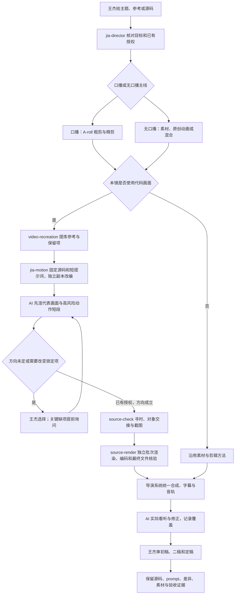

# 源码驱动制作与导演系统落位

有可用源码和参考画面时，保持口播/无口播两条主线，在具体镜头或原创动画模块采用源码驱动方法。承接用户已选主题和风格，先明确原片复现、源码改编或参考原创，避免把三类任务混作同一次能力对比。



AI 自行实现与修复；王杰选择方向、关键表达、新音色并审最终成片。已明确授权内不每镜等待。必要素材、权限、成本或画面目标存在实质冲突时，先做独立可完成部分，再带着具体证据和方案询问，不用重复安装库或扩大流程代替解决问题。

## 三个已接入命令

```powershell
& (Join-Path $directorRoot 'scripts/run-video.ps1') -Command source-doctor -ToolArgs @('--spec',$spec)
& (Join-Path $directorRoot 'scripts/run-video.ps1') -Command source-check -ToolArgs @('--spec',$spec,'--output',$newCheckDir)
& (Join-Path $directorRoot 'scripts/run-video.ps1') -Command source-render -ToolArgs @('--spec',$spec,'--output',$newJobDir,'--workers','3')
```

`spec`随真实项目保存，声明模式、源码范围、分辨率/fps/时长、声音合同、源码时间映射、渲染入口和需要检查的动作边界。浏览器后端支持可按时间出一帧的 Canvas、p5 或适配后的 WebGL/Three/DOM 工程；“同接口可以适配”不等于各库全部效果已测试。原生命令后端可承接 Python 等现有渲染程序，不强制重写原栈。详细契约从本宿主已启用的`jia-motion / references/source-backed.md`读取。

没有`jia-motion`时可以调用本机真实运行器处理已准备好的工程，但不得声称已运行未启用的 Skill。运行器本机位置：`E:/开发项目/视频剪辑skill/runtime/source-film`。默认环境与案例目录从工作区`config/video-workflow.json`读取，不自动下载依赖或调用外部 API。

## 工作包与状态

交付保留创作 prompt、brief、参考/源码及版本、保留与修改项、可修改工程、实际素材与字体、时间映射、关键动作边界、新版本 MP4 和 QA 回执。源码检查、最终 MP4 技术检查、实际画面看听、本人确认与发布分开记录。

命令输出静音代码母版时，后续声音仍按既有合同和唯一音轨 owner 处理，不把静音母版伪装成已完成配音。源码工作包不写核心项目的确认状态，不把生成动画冒作真实 A-roll，也不绕过已有粗剪/精剪或发布权限。

本轮保留原40节点、素材/口播/动画/混合制作、声音和现有合成器；新增的是能实际运行并留证据的源码制作入口。已检查的案例与局部范围由发布回执给出，不从“封装完成”推断所有风格或所有宿主已经审片通过。

规格示例实际位于已启用的 jia-motion 的 assets/source-film 目录，导演包内不重复存放。跨 Agent 的角色资产、动作短段、独立审核与返修按 [执行与审核](execution-review.md)。
